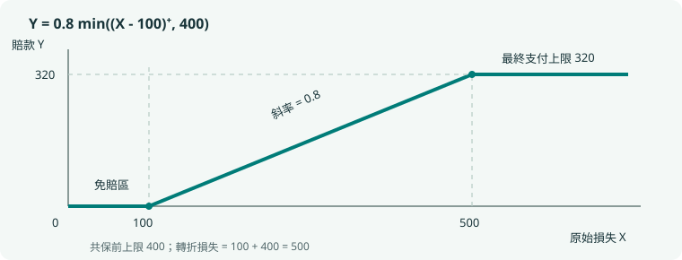

# 觀念推導與 24 個典型例題

第二版增補，2026-10-15。本冊把「為什麼選這個模型」和「公式怎麼來」補在速查筆記之後。例題 E01–E24 全部為本次原創教學例，不計入 180 道五選一題庫。現行範圍仍以 [SOA 2026 年 11 月考綱](https://www.soa.org/globalassets/assets/files/edu/2026/fall/syllabi/2026-11-exam-p-syllabus.pdf) 為準；ASM 章節、正文與掃描頁次對照見 00 文件。

建議先遮住解答，寫出隨機變量、支持集、支付函數或條件事件，再開始計算。題目背景可以改變，這四件事通常決定解法。

## 一、從題面建立機率模型

### E01｜三事件：用互斥小區域避免重複計數

**對應：ASM 1；考綱 1a、1e；後續練習 P002、P027、A001。**

三事件的機率分別為 $0.50,0.45,0.30$，三個兩兩交集依序為 $0.20,0.15,0.10$，三重交集為 $0.05$。求恰好兩個發生的機率。

**辨識。** 每個兩兩交集都包含三重區域。若把三個交集直接相加，三重區域會被算三次；而它在「恰好兩個」中應計零次。

**計算。** 三個只有兩者的區域分別為 $0.20-0.05=0.15$、$0.15-0.05=0.10$、$0.10-0.05=0.05$，合計 $0.30$。

**重建公式。** 設兩兩交集和為 $S_2$，三重交集為 $t$，則 $P(\text{恰好兩個})=S_2-3t$；$P(\text{至少兩個})=S_2-2t$。差別正是三重區域是否保留一次。

**自查。** 七個非空互斥區域為 $0.20,0.20,0.10,0.15,0.10,0.05,0.05$，均非負；聯集 $0.85$。這也檢查題目提供的比例是否可行。

### E02｜無放回：條件化後重新盤點母體

**對應：ASM 2、3、17；考綱 1b、1f；練習 A003。**

12 份文件中有 5 份錯誤。無放回抽 4 份，已知至少一份錯誤，求恰好兩份錯誤的機率。

**辨識。** 原來的計數是超幾何；現在再限制在「至少一份錯誤」的樣本子集上。不是把錯誤率重新當成獨立成功率。

$$P(X=2\mid X\ge1)=\frac{\binom52\binom72}{\binom{12}4-\binom74}=\frac{210}{460}=\frac{21}{46}.$$

**另一個想法。** 先算兩個無條件機率，再相除，分母中的 $\binom{12}4$ 會約去。由計數式可直接看出每個等可能子集的角色。

**容易錯。** 寫成 $\binom42(5/12)^2(7/12)^2$ 使用了放回模型；即使數值接近也不是同一個實驗。

### E03｜相同風險客戶：條件獨立不等於邊際獨立

**對應：ASM 4、16；考綱 1g；練習 P017、A004、A010。**

高風險占 30%，每年無賠機率 0.60；低風險占 70%，每年無賠機率 0.90。給定類別後各年獨立。同一客戶兩年無賠後，求其為高風險的機率。

**分組似然。** 高風險產生觀測的機率是 $0.6^2$，低風險是 $0.9^2$。先驗與似然相乘，再正規化：

$$P(H\mid00)=\frac{0.3(0.6)^2}{0.3(0.6)^2+0.7(0.9)^2}=0.16.$$

單年邊際無賠機率是 $0.81$；但同一人兩年無賠為 $0.675$，不是 $0.81^2=0.6561$。連續觀測也在提供客戶類別的資訊。

**預測。** 第三年索賠機率為 $0.16(0.4)+0.84(0.1)=0.148$。先更新組別，再按更新後組別權重預測。

### E04｜「至少一個」與「指定第一個」是不同的資訊

**對應：ASM 3；考綱 1f；練習 P020、P117、A014。**

甲乙獨立索賠率均為 $p=0.2$。若知道至少一個索賠，求兩者都索賠的機率。

四個結果為：都不索賠 $0.64$、只有甲 $0.16$、只有乙 $0.16$、兩者都索賠 $0.04$。去掉第一格後重新正規化，得到 $0.04/(0.16+0.16+0.04)=1/9$。

若知道**甲已索賠**，樣本空間則只有「只有甲」與「兩者都索賠」，答案為 $0.04/(0.16+0.04)=0.2$。同一個字「已知」，背後的資訊可能不同。

## 二、分布、期望與參數的理解

### E05｜CDF 跳躍：連續損失也可以產生混合賠款

**對應：ASM 5；考綱 2a、2e；練習 P035、P088、A032。**

$X\sim U(0,100)$，賠款 $Y=\min((X-20)^+,50)$。求完整賠款分布。

**先寫支付。** $X\le20$ 時 $Y=0$；$20<X<70$ 時 $Y=X-20$；$X\ge70$ 時 $Y=50$。

$$F_Y(y)=\begin{cases}0,&y<0,\\(y+20)/100,&0\le y<50,\\1,&y\ge50.\end{cases}$$

有質量 $P(Y=0)=0.2$、$P(Y=50)=0.3$，中間區間密度為 $1/100$。檢查：$0.2+50(1/100)+0.3=1$。

**為什麼不能只微分？** 微分只留下中間的 0.5 機率，會漏掉兩端合共 0.5 的質量。涉及 CDF 的單點請用跳躍大小。

### E06｜求期望不必先求變換後的密度

**對應：ASM 7、8；考綱 2c、2d；練習 A019、A042。**

$X$ 取 $0,1,3$，機率為 $0.2,0.5,0.3$，令 $Y=(X-1)^2$。求 $E[Y]$ 與 $\operatorname{Var}(Y)$。

三種結果的 $Y$ 值為 $1,0,4$。直接用原始機率加權：$E[Y]=0.2+1.2=1.4$，$E[Y^2]=0.2+4.8=5$，故方差為 $5-1.4^2=3.04$。

**對照錯法。** $E[X]=1.4$，但 $(E[X]-1)^2=0.16$，與 $E[(X-1)^2]=1.4$ 不同。函數一般不能穿過期望符號。

### E07｜二項、超幾何、負二項：先看什麼固定

**對應：ASM 17、18；考綱 2a；練習 A003、A021–A022。**

成功率 $p=0.3$ 的獨立試驗中，求第 2 次成功恰在第 5 次出現的機率。

**固定的是成功次數。** 最後一次必須成功；前四次恰有一次成功。因此答案是 $\binom41(0.3)^2(0.7)^3=0.12348$。

若改問「五次中恰好兩次成功」，則最後一次不必成功，答案改成 $\binom52(0.3)^2(0.7)^3$。若從有限母體無放回抽五件，則應改用超幾何。

**選模表。** 固定試驗數、獨立同機率 → 二項；固定成功數、等到完成才停 → 負二項；有限母體無放回 → 超幾何。

### E08｜Poisson 相鄰機率比為什麼有用

**對應：ASM 19；考綱 2a、2c；練習 P054、A023。**

已知 $N\sim\operatorname{Poisson}(\lambda)$，且 $P(N=4)=2P(N=3)$，求 $\lambda$ 與 $P(N=0)$。

$$\frac{P(N=4)}{P(N=3)}=\frac{\lambda}{4}=2\quad\Rightarrow\quad\lambda=8.$$

因此 $P(N=0)=e^{-8}$。比值法約掉階乘、指數與共同冪次，可用來反推參數，也可用來判斷眾數：機率在比值大於 1 時仍上升，小於 1 時開始下降。

**邊界。** 整數參數 8 時，7 與 8 是兩個眾數；不是只有 8。

### E09｜指數無記憶：剩餘壽命與總壽命分開

**對應：ASM 20；考綱 2b、2c；練習 P059、A027–A028。**

$X$ 為均值 6 的指數壽命。已知 $X>4$，求 $E[X\mid X>4]$ 與 $P(7<X\le10\mid X>4)$。

令剩餘壽命 $R=X-4\mid X>4$，則 $R\sim\operatorname{Exp}(6)$。總壽命條件均值為 $4+6=10$；事件區間改成 $3<R\le6$，故機率 $e^{-3/6}-e^{-6/6}$。

**自查。** 若把均值答為 6，等於把已經經過的四年丟掉。無記憶的是「還要等多久」，並非總長度。

### E10｜Gamma 的參數從均值、方差重建

**對應：知識點 §8.3；考綱 2a、2c、2d；練習 A025。**

Gamma 損失均值為 18、方差為 54，求形狀、尺度及 $E[X^2]$。

由 $m=\alpha\theta,v=\alpha\theta^2$ 得 $\theta=v/m=3$、$\alpha=m^2/v=6$。二階矩為 $v+m^2=54+324=378$。

若題目用率參數，則率為 $1/3$，不是 3。把同一個數字直接代入另一套參數公式會造成系統性錯誤。

**連結。** 在 Poisson 到達模型中，等待第 6 次到達的時間也可用相同形狀建模，但要確認到達率與時間單位。

### E11｜Beta 的指數比參數少一

**對應：知識點 §8.4；考綱 2a、2c、2d；練習 A026。**

$f(x)=cx^2(1-x)$，$0<x<1$。求 $c$、均值、方差。

對照 $x^{\alpha-1}(1-x)^{\beta-1}$，得 $\alpha=3,\beta=2$，不是 2 與 1。正規化積分為 $\int_0^1(x^2-x^3)dx=1/12$，故 $c=12$。

均值 $3/5=0.6$；方差 $3(2)/[5^2(6)]=0.04$。也可逐次積分求 $E[X]$、$E[X^2]$，再相減，作為交叉檢查。

### E12｜常態百分位：從兩條方程反推參數

**對應：ASM 21；考綱 2c；練習 A029。**

常態分布第 10、90 百分位為 70、110，使用 $z_{.90}=1.281552$，求均值與標準差。

對稱性給均值 $\mu=(70+110)/2=90$。再由 $110=90+1.281552\sigma$ 得 $\sigma=20/1.281552\approx15.6061$。

一般兩百分位不一定對稱，應解 $q_a=\mu+\sigma z_a,q_b=\mu+\sigma z_b$。如果需要方差，最後再平方。

## 三、保險支付：從函數到分布與矩

### E13｜從支付圖讀懂免賠、共保、上限

**對應：ASM 5.1、7、8；考綱 2e、2f；練習 A030–A034。**

原損失 $X\ge0$，免賠額 100，共保前賠款上限 400，保險人比例 0.8。

$$Y=0.8\min((X-100)^+,400)=\begin{cases}0,&X\le100,\\0.8(X-100),&100<X<500,\\320,&X\ge500.\end{cases}$$

斜率 0.8 表示每增加 1 單位超額損失，保險人多賠 0.8；平台高度 320 是**最終**賠款上限。若文字改成「最終賠款上限 400」，平台就應是 400，轉折損失為 $100+400/0.8=600$。

**檢查點。** 當 $X=80,300,700$，賠款應為 $0,160,320$。先檢查這三個位置，再做積分，可以提早發現條款順序錯誤。

### E14｜尾積分公式：把金額看成一層層指示變量

**對應：ASM 7；考綱 2c、2f；練習 A030。**

對非負金額 $Y$，把它寫成 $Y=\int_0^\infty\mathbf1_{\{Y>y\}}dy$，再取期望：

$$E[Y]=\int_0^\infty P(Y>y)dy.$$

這是對生存函數下方的面積求和。普通免賠 $Y=(X-d)^+$ 對應 $P(Y>y)=P(X>d+y)$，換元得到 $E[Y]=\int_d^\infty S_X(x)dx$。

例：均值 500 的指數損失，免賠 200，期望賠款為 $500e^{-0.4}$。若共保前上限 600，右端截在 $200+600=800$，變成 $500(e^{-0.4}-e^{-1.6})$。

**二階矩同理。** $Y^2=\int_0^Y2y\,dy$，所以 $E[Y^2]=2\int_0^\infty yP(Y>y)dy$。這個推導比死記賠款二階矩更容易檢查。

### E15｜每次支付的方差不能直接除啟賠率

**對應：ASM 8、20；考綱 2f；練習 P084、A031。**

均值 500 的指數損失，免賠額 200，無上限，令 $s=e^{-0.4}$。每次損失賠款均值 $500s$，二階矩 $2(500)^2s$。

給定正賠款後，先分別正規化：

$$E[Y\mid Y>0]=500,\qquad E[Y^2\mid Y>0]=2(500)^2.$$

因此條件方差為 $500^2=250000$。若用無條件方差除以 $s$，會得到 $500^2(2-s)$，多出一個錯誤項。

**原因。** 方差含有均值的平方；條件化會改變均值，不能只對整個方差做一次除法。

### E16｜通膨：先改損失，還是連條款一起改

**對應：ASM 5.1、8；考綱 2e、2f；練習 A033。**

$X\sim U(0,1000)$，免賠 200。損失通膨 10%，條款保持不變，求期望賠款。

新損失 $X'=1.1X\sim U(0,1100)$，支付為 $(X'-200)^+$，故期望為 $900^2/(2\cdot1100)=368.1818$。

若**免賠額也**同比增至 220，支付才是 $1.1(X-200)^+$，期望為 $1.1(320)=352$。這兩個答案對應不同保單條款。

**讀題提示。** fixed deductible、indexed deductible、benefit limit applies after coinsurance 都應先翻成數學函數，不能只看關鍵字套公式。

## 四、多變量：表格、相依與條件化

### E17｜聯合表格一次算出邊際、條件與協方差

**對應：ASM 11–14；考綱 3a–3e；練習 A045–A048。**

| $Y\backslash X$ | 0 | 1 | 2 |
| --- | --- | --- | --- |
| 0 | 0.10 | 0.20 | 0.10 |
| 1 | 0.20 | 0.10 | 0.30 |

列出 $X$ 的邊際為 $0.3,0.3,0.4$；$Y=1$ 的機率為 $0.6$。所以 $E[X]=1.1,E[Y]=0.6,E[XY]=0.1+2(0.3)=0.7$，協方差 $0.7-1.1(0.6)=0.04$。

條件 $Y=1$ 下，$X$ 的機率變成 $1/3,1/6,1/2$，條件均值 $7/6$，二階矩 $13/6$，方差 $13/6-(7/6)^2=29/36$。

**先後順序。** 邊際先加，條件再除，矩最後乘權重。若還沒正規化就算條件矩，通常會少除一次條件機率。

### E18｜全方差為什麼多一項

**對應：ASM 16；考綱 2d、3c、3d；練習 A037、A048。**

兩類客戶各半，條件均值為 1、5，條件方差為 2、6。無條件均值 $3$，方差為 $4+4=8$。

推導可從 $X-\mu=[X-E(X\mid H)]+[E(X\mid H)-\mu]$ 開始。展開平方後，交叉項條件期望為 0，留下「組內變異」與「組間均值變異」。

$$\operatorname{Var}(X)=E[\operatorname{Var}(X\mid H)]+\operatorname{Var}(E[X\mid H]).$$

若兩類均值一樣，第二項才消失。不同風險客戶混合後的方差，可能比每一組內的方差都大。

### E19｜零相關但仍相依：檢查一個條件事件

**對應：ASM 13；考綱 3e；練習 P114、A049。**

$X$ 等可能取 $-1,0,1$，$Y=X^2$。由對稱性 $E[X]=E[X^3]=0$，所以協方差為 0。

但 $P(Y=0\mid X=0)=1$，而 $P(Y=0)=1/3$，條件機率已改變，故不獨立。

**重點。** 相關係數只量度線性關係；「Y 由 X 決定」可以是非線性的。除非額外有適用的結構條件，不要把零相關升格為獨立。

### E20｜Poisson 給定總數：把到達分配成二項

**對應：ASM 11、19；考綱 3b、3g；練習 P108、A050。**

$X\sim\operatorname{Poisson}(2),Y\sim\operatorname{Poisson}(3)$ 獨立，已知 $X+Y=4$，求 $P(X=1\mid X+Y=4)$。

先用聯合機率除以總數機率：

$$\frac{(e^{-2}2/1!)(e^{-3}3^3/3!)}{e^{-5}5^4/4!}=\binom41(2/5)(3/5)^3=0.3456.$$

一般形式是 $X\mid X+Y=n\sim\operatorname{Bin}(n,\lambda_X/(\lambda_X+\lambda_Y))$。原本兩個次數獨立，給定總和後不再獨立；一邊多一次，另一邊就少一次。

## 五、次序統計量與大樣本近似

### E21｜第 k 小：改寫成落在門檻左邊的人數

**對應：ASM 23；考綱 3f；練習 A053–A054。**

4 個 IID $U(0,1)$ 觀測，求第 2 小大於 0.3 的機率。

第 2 小仍大於 0.3，代表至多一個觀測不超過 0.3。令 $B$ 為這個人數，則 $B\sim\operatorname{Bin}(4,0.3)$，所以答案為 $0.7^4+4(0.3)(0.7)^3=0.6517$。

**重建方法。** 先畫門檻，再把事件翻成「至多 k−1」或「至少 k」，最後才使用二項式。即使母體不是均勻，只要 IID，成功率都可以換成 $F(t)$。

### E22｜兩個次序統計量：分三區做聯合計數

**對應：ASM 23；考綱 3f；練習 P119、A055。**

4 個 IID $U(0,1)$，求 $P(X_{(1)}>0.2,X_{(3)}\le0.7)$。

第一個條件要求沒有人落在 $[0,0.2]$；第二個要求至少三人落在 $(0.2,0.7]$。因此只有兩種數量組合：三人中段、一人右段，或四人中段。

$$\binom43(0.5)^3(0.3)+(0.5)^4=0.2125.$$

**容易錯。** 把兩個次序統計量事件的機率直接相乘，等於假設它們獨立。它們來自同一批樣本，通常明顯相依。

### E23｜常態線性組合是精確結果，CLT 是近似

**對應：ASM 21、22；考綱 3g–3i；練習 A052、A059–A060。**

若獨立 $X\sim N(20,4^2),Y\sim N(10,3^2)$，則 $2X-Y\sim N(30,73)$。因此 $P(2X-Y>40)=1-\Phi(10/\sqrt{73})$，這是精確分布運算。

若改成 100 筆 IID、各均值 20、標準差 4，但母體不是常態，則總和只是用 CLT **近似**為 $N(2000,1600)$。二者用同一套標準化，依據卻不同。

**係數自查。** $\operatorname{Var}(2X-Y)=4\operatorname{Var}(X)+\operatorname{Var}(Y)$；減法不會把 Y 的方差變負。

### E24｜格點與連續性修正：為什麼不總是 0.5

**對應：ASM 22；考綱 3i；練習 P109、A057。**

$N\sim\operatorname{Bin}(100,0.2)$，求 $P(N\ge25)$ 的常態近似。均值 20，標準差 4；格點間距 1，邊界移到 $24.5$，得到 $1-\Phi((24.5-20)/4)$。

若改問 $S=200N$，則 S 的格點間距為 200，事件 $S\ge5000$ 對應的連續門檻應為 4900。標準化後仍是 $(4900-4000)/800=1.125$。

**錯法。** 對所有金額一律加減 0.5，忽略其離散格距。連續損失的總和則不需要這種修正。

## 六、快速選模決策表與薄弱點回補

| 問題先問什麼 | 若答案是 | 優先工具 |
| --- | --- | --- |
| 是否已知一個事件？ | 是 | 先寫分母；條件化後重新正規化 |
| 抽樣是否放回？ | 無放回有限母體 | 超幾何／逐步條件機率 |
| 試驗數固定，還是成功數固定？ | 前者／後者 | 二項／負二項 |
| 同一類客戶連續觀測？ | 有潛在風險組別 | 每組似然 → Bayes → 預測 |
| 金額是否有免賠與上限？ | 是 | 先寫分段支付函數 |
| 是損失、每次損失賠款或每次正賠款？ | 三者分清 | 正賠款要額外條件化 |
| 要變換後的矩還是分布？ | 只要矩 | 直接算 $E[g(X)]$ |
| 是第 k 小或最大最小？ | 是 | 轉成門檻左右的計數事件 |
| 母體已常態且獨立？ | 是 | 精確常態組合 |
| IID 大樣本總和但母體非正態？ | 有有限正方差 | CLT，檢查尺度與近似前提 |

**做錯後怎麼補。** 題面讀錯就重寫支付函數或事件；選模錯就回看上表；公式錯就自己重推一次；算術錯就用另一種方法交叉核對；時間不足則重做同題並記錄最短合理解法。不要把背答案當作掌握。

**建議檢查點。** E01–E04 可閉卷後再做一般機率新題；E05–E16 對應單變量；E17–E24 對應多變量。進階 A 題的英文題面可先單獨閱讀，中文僅在確認理解時查看。
